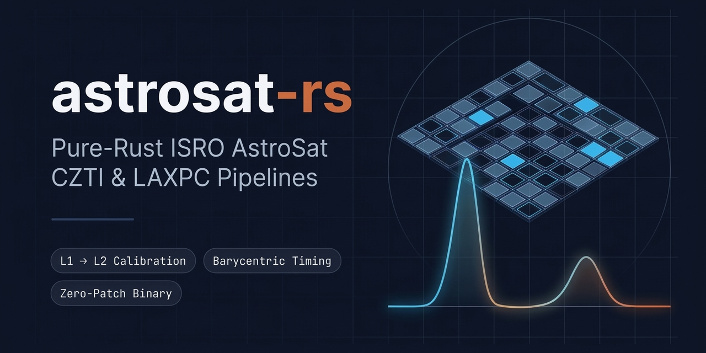

<p align="center">
  
</p>

# `astrosat-rs`

A production-grade, `rayon`-parallelized, **zero-patch pure-Rust** redesign of ISRO AstroSat's **CZTI** (Cadmium Zinc Telluride Imager) and **LAXPC** (Large Area X-ray Proportional Counter) Level-1 to Level-2 scientific pipelines and Solar System Barycentric timing engine.

- **Zero C/C++/Fortran/HEASoft dependencies**: No `cfitsio`, `glog`, `pil`, `gfortran`, `libssl`, `preplaxbary`, or `$HEADAS` setup required. Compiles into a single standalone binary linked only against standard system libraries (`libc`, `libm`, `libgcc_s`).
- **Zero-copy FITS 4.0 + OGIP engine**: Memory-mapped (`memmap2`) reading/writing, `CONTINUE` long strings, Seaman/Pence `CHECKSUM`/`DATASUM`, and OGIP-compliant `EVENTS`, `GTI`, `SPECTRUM`, `RATE`, `RESPONSE` (`MATRIX` + `EBOUNDS`), `ORBIT`, and `IMAGE` (WCS) products verified with NASA HEASARC `fitsverify 4.22` (`0` errors, `0` warnings).
- **Verified scientific parity**: Head-to-head numerically verified against untouched legacy **IUCAA CZTI Pipeline v3.0.1**, **LaxpcSoft v3.4.6**, and **NASA/IUCAA `as1bary`** (with official NASA JPL binary DE405 & HEASARC FITS `JPLEPH.405`/`JPLEPH.200`).
- **Massively parallel & deterministic**: Multi-core `rayon` parallelism across CZTI quadrants/pixels/sky grids, LAXPC units/orbits/event chunks, and barycentric corrections with deterministic `--threads 1` vs `--threads N` output.

---

## Quickstart & Zero-Patch Standalone Install

### Prerequisites
- Rust toolchain (`rustc` + `cargo`, via [rustup](https://rustup.rs)) — **no C/C++/Fortran scientific libraries needed**.

### Clone & Install (No `sudo` Required)

```bash
git clone https://github.com/meural-operator/astrosat-rs.git
cd astrosat-rs

# Default prefix: $HOME/.local/bin/astrosat
./scripts/install.sh

# Or specify any custom prefix
./scripts/install.sh --prefix /opt/astrosat-rs
# Or via environment variable:
PREFIX=/path/to/install ./scripts/install.sh
```

Or build directly with Cargo:

```bash
cargo build --release -p astrosat-cli
./target/release/astrosat --help
```

`scripts/install.sh` builds the optimized `--release` binary (`astrosat`), installs it to `$PREFIX/bin/astrosat`, smoke-tests `--help` across subcommands, and audits shared library linkage via `ldd` to confirm zero dependency on `cfitsio`, `heasoft`, `glog`, `pil`, or `libgfortran`.

---

## CLI Usage Examples

Every command supports `--threads N` (Rayon worker pool), `--json` (machine-readable output), `--config <file.toml|json>`, and `--help`.

### 1. Full CZTI Level-1 -> Level-2 Pipeline (Stages 1–3)

```bash
astrosat czti run \
  --input <DATA_DIR>/czti/20160331_T01_112T01_9000000406_level1 \
  --caldb <CALDB_DIR>/czti \
  --output ./out_czti_9000000406 \
  --threads 16
```

Individual CZTI stages are also exposed directly (`decode`, `bunchclean`, `pha2energy`, `gtigen`, `gaas`, `datasel`, `clean`, `evtencor`, `evtclean`, `dpigen`, `image`, `bindata`, `addspec`):

```bash
# Generalized v3.0 noise cleaning
astrosat czti clean \
  -i ./out_czti_9000000406/AS1T01_112T01_9000000406cztM0_level2_bc.evt \
  --caldb <CALDB_DIR>/czti \
  --algo generalized \
  -o ./clean.evt

# Co-add multi-quadrant or multi-ObsID spectra & exposure-weighted RMFs (cztaddspec)
astrosat czti addspec \
  --pha ./out_czti_9000000406/*_Q0.pha ./out_czti_9000000406/*_Q1.pha \
  --rsp ./out_czti_9000000406/*_Q0.rsp ./out_czti_9000000406/*_Q1.rsp \
  -o ./combined.pha --out-rsp ./combined.rsp
```

### 2. Full LAXPC Level-1 -> Level-2 Pipeline (LAXPC10/20/30)

Single-command multi-unit reduction with automatic orbit discovery, Format B + Format A outputs, and `AstroSat.orb` generation:

```bash
astrosat laxpc run \
  --input <DATA_DIR>/laxpc_l1/20160107_G02_010T01_9000000252_level1 \
  --caldb <CALDB_DIR>/laxpc \
  --output ./out_laxpc_9000000252 \
  --format-a \
  --threads 16
```

Per-stage subcommands (`decode`, `gtigen`, `lightcurve`, `spectrum`, `backshift`, `orbit`) are also available:

```bash
astrosat laxpc lightcurve \
  --ea <DATA_DIR>/laxpc_l1/.../lxp1/modeEA/*lxp1EA_level1.fits \
  --mkf <DATA_DIR>/laxpc_l1/.../*lxp_level1.mkf \
  --tct <DATA_DIR>/laxpc_l1/.../aux/*lxp_level1.tct \
  --caldb <CALDB_DIR>/laxpc \
  --energy-range 3:20 \
  --tbin 0.01 \
  --layer1-only \
  -o ./crab_10ms.lcurv
```

### 3. Solar System Barycentric Correction (`astrosat bary`)

Works natively on CZTI `.evt`, LAXPC Format B `.evn`/`.lcurv`, and LAXPC Format A `level2.event.fits` (automatically resolving HDU-0 vs HDU-1 keywords and rejecting accidental double-barycentering on `TIMESYS='TDB'` — zero `preplaxbary` hacks, zero `$HEADAS` setup):

```bash
# Built-in analytical ephemeris (~4-9 ms accuracy vs DE405, zero external files)
astrosat bary \
  ./out_laxpc_9000000252/level2.event.fits \
  --orbit ./out_laxpc_9000000252/AstroSat.orb \
  --ra 83.6331 --dec 22.0145 \
  -o ./level2_bary.event.fits

# External JPL DE200/DE405/DE421/DE430 (supports BOTH raw JPL binary AND NASA HEASARC FITS JPLEPH.405/200; <= 30 ns parity)
astrosat bary \
  ./out_laxpc_9000000252/lxp1level2.evn \
  --orbit ./out_laxpc_9000000252/AstroSat.orb \
  --ephem <EPHEM_DIR>/JPLEPH.405 \
  -o ./lxp1level2_bary.evn
```

### 4. FITS Inspection, Validation & Pulsar Timing

```bash
astrosat inspect ./out_laxpc_9000000252/level2.event.fits --full
astrosat validate ./out_czti_9000000406/*.pha --strict
astrosat timing ./level2_bary.event.fits --freq 29.66 --search-span 0.05 --harmonics 2
```

### 5. AstroSat Studio — Embedded Zero-Dependency Web Workbench (`astrosat ui`)

`astrosat ui` launches **AstroSat Studio** directly from the same standalone binary (100% offline — zero Node, Python, or external CDN dependencies):

```bash
# Opens AstroSat Studio at http://127.0.0.1:8080/ (Classic UI preserved at /classic)
astrosat ui --data-dir /path/to/astrosat/data

# Headless / SSH port-forwarding mode on a custom port
astrosat ui --host 127.0.0.1 --port 8086 --data-dir /path/to/astrosat/data --no-open
```

- **Full CLI-parity pipeline runner & tools:** Run `czti run`, `laxpc run`, `bary`, `czti addspec` (multi-spectrum/response co-adding), and `laxpc backshift` (gain/background shifting) in-process with collapsed **Advanced options** drawers and live **Copy command** / two-way **Load & Download `.toml`** config round-trip.
- **Interactive scientific plots & inspection:** Dynamic rebinned light curves with GTI shading, channel/keV spectra, 2D CZTI DPH/DPI/sky images with live WCS coordinates, multi-band phase-folded pulse alignment + $Z^2_n$ periodogram search + circular cross-correlation phase lags, FITS HDU/header/row inspector + strict OGIP validation, Light/Dark themes, and publication SVG/PNG export.

---

## Architecture Overview (7 Core Crates)

| Crate | Purpose | Documentation |
| :--- | :--- | :--- |
| `astrosat-fits` | Zero-copy `memmap2` FITS 4.0 reader/writer, `CONTINUE`, `CHECKSUM`/`DATASUM`, OGIP builders | [Architecture Guide](docs/architecture.md) |
| `astrosat-core` | AstroSat `MJDREFI=55197` timing, leap seconds, CZTI/LAXPC TCT, `GtiSet`, 2nd-order Taylor orbit, `as1bary` SSB engine (analytical + raw JPL DE + HEASARC FITS `JPLEPH.*`), CALDB CIF, shared TOML config | [Architecture Guide](docs/architecture.md) |
| `astrosat-czti` | 3-stage `rayon`-parallelized CZTI pipeline (`science2event` -> `bindata`/`.rsp` + `addspec`) | [CZTI Pipeline Docs](docs/czti_pipeline.md) |
| `astrosat-laxpc` | Multi-unit `rayon`-parallelized LAXPC10/20/30 pipeline + 2D B-spline background, `BackgroundCatalog`, & RMF selection | [LAXPC Pipeline Docs](docs/laxpc_pipeline.md) |
| `astrosat-ui` | Zero-dependency embedded **AstroSat Studio** web workbench (`/` default, `/classic` preserved) with full CLI-parity job runner, TOML round-trip, WCS 2D imaging, and multi-band pulse alignment | [`crates/astrosat-ui`](crates/astrosat-ui/src/lib.rs) |
| `astrosat-cli` | Unified `astrosat` CLI (`czti`, `laxpc`, `bary`, `inspect`, `validate`, `timing`, `ui` — 29 subcommands) | [Legacy Migration Guide](docs/migration_from_legacy.md) |
| `astrosat-bench` | Reproducible latency, throughput, `rayon` scaling, and `/proc/self/status` `VmHWM` RSS suite | [`crates/astrosat-bench`](crates/astrosat-bench/src/main.rs) |

Detailed technical documentation:
- [docs/architecture.md](docs/architecture.md)
- [docs/czti_pipeline.md](docs/czti_pipeline.md)
- [docs/laxpc_pipeline.md](docs/laxpc_pipeline.md)
- [docs/migration_from_legacy.md](docs/migration_from_legacy.md)

---

## Head-to-Head Verification vs Legacy Pipelines & NASA Ephemerides

`astrosat-rs` was verified head-to-head against untouched legacy **IUCAA CZTI Pipeline v3.0.1**, **LaxpcSoft v3.4.6**, and **NASA/IUCAA `as1bary`** using real AstroSat Crab observations (`9000000406`, `9000002432`, `9000000252`) and official NASA JPL binary DE405 (`lnxp1600p2200.405`) + NASA HEASARC FITS `JPLEPH.405`/`JPLEPH.200`:

| Domain | Legacy Oracle | Head-to-Head Parity Summary | Audit Report |
| :--- | :--- | :--- | :--- |
| **Solar System Barycentering (`astrosat bary`)** | NASA/IUCAA `as1bary` + JPL DE405 & HEASARC `JPLEPH.405`/`JPLEPH.200` | **`0–29.8 ns` (0–1 IEEE-754 `f64` ULP)** on live orbits across CZTI (`185,459` events), LAXPC Format A/B (`8.94M–25.82M` events), 2016->2017 leap second (`0.00 ns` step diff), near-limb solar conjunction (`-107.81 us` Shapiro delay, `0.00 ns` diff), `FK5->ICRS`, and `JPLEPH.405` vs raw DE405 (`0.00 ns` bit-exact). Crab pulsar absolute phase parity: **`+1.26 ns` (`3.74e-8` cycles)**; **7x–15x faster** than `as1bary`. | [heasoft_as1bary_numerical_verification.md](audit/heasoft_as1bary_numerical_verification.md) |
| **CZTI L1->L2 (`astrosat czti`)** | IUCAA CZTI Pipeline v3.0.1 (19 modules) & Official L2 (`9000000406`, `9000002432`) | **0 diff** on Stage 1 decoded events (`2.40M`) & bunches (`391,551`); **`0.000000 s` diff** across all 5 GTI HDUs (`GTI`, `Q0..Q3_GTI`); **`0` `QUALITY`/`GROUPING` mismatches** across 2,048 channels; Q0/Q2/Q3 `.pha` agree to **`7.9e-7% – 2.3e-6%`** (`r = 0.99999999999997`), `.rsp` to `r >= 0.99999999990`, `addspec` to `r = 1.0`; fixes legacy C++ `float32` temperature cancellation & `cztimage` UB crashes. | [czti_head2head_verification.md](audit/czti_head2head_verification.md) |
| **LAXPC L1->L2 (`astrosat laxpc`)** | LaxpcSoft v3.4.6 (`laxpcl1.f`, `backshiftv3.f`) & Official L2 (`9000000252`) | **0-event diff** across LX10/20/30 (`8.92M / 8.78M / 8.06M` events), `0` channel diffs; **bit-exact (`max_abs = 0.0`)** `1.0 s` light curves; `0.01 s` light curves agree to **`<= 2.46e-10` cps** (`r = 1.0`); `256/512/1024`-ch spectra match to **`<= 3.12e-8` cps** (`r = 1.0`); `backshift` & post-day-917 `cshm` shifted channel maps match `backshiftv3.e` to **`0.0 – 8.88e-16` cps** (`r = 1.0`, 13-digit exact `fshbk`). | [laxpc_head2head_verification.md](audit/laxpc_head2head_verification.md) |
| **End-User & Adversarial Suite** | NASA `fitsverify 4.22` + 8 public-release workflows | **`149/149`** FITS products pass `fitsverify 4.22` (`0` errors, `0` warnings); **`0` panics** across 69 corrupt/adversarial inputs; `env -i` determinism verified. | [public_release_scenario_report.md](audit/public_release_scenario_report.md) |
| **Crab Pulsar Radio Cross-Check (`bary` + `timing`)** | Official Jodrell Bank Observatory Crab Monthly Ephemeris (`crab2.txt`) | Measured 2.77-yr spin-down across Jan 2016 LAXPC (`9000000252`) -> Oct 2018 CZTI (`9000002432`): frequency agrees to **`+89 nHz` (`3 ppb`, `0.20σ`)** & **`+229 nHz` (`8 ppb`, `0.11σ`)**; mean $\dot{f} = -3.68866 \times 10^{-10}\text{ Hz/s}$ matches Jodrell Bank to **`0.00044%`** (`4.4 ppm`). | — |

---

## Benchmark Summary

Reproducible `--release` benchmarks with isolated child processes and `/proc/self/status` `VmHWM` peak RSS tracking:

```bash
./scripts/run_benchmarks.sh
```

Measured on a 52-vCPU Linux/WSL2 host (62.6 GiB RAM):

| Benchmark | 1T (ms) | 4T (ms) | 16T (ms) | 52T (ms) | Best Speedup | Peak RSS @ MaxT (MiB) | Workload Notes |
| :--- | ---: | ---: | ---: | ---: | ---: | ---: | :--- |
| `bary_synth` | 6402.96 | 2029.18 | 601.79 | 252.24 | **25.38x** | 35.6 | 1M timestamps (`3.96M events/s` @ 52T) |
| `bary_fits_real` | 1680.83 | 810.17 | 606.76 | 565.99 | **2.97x** | 76.9 | ObsID `9000000406` `.evt` + `.orb` (11 HDUs) |
| `fits_io_real` | 763.62 | 513.07 | 532.88 | 552.77 | **1.49x** | 72.4 | CZTI + LAXPC L1 BINTABLEs (`187 MB/s` @ 4T) |
| `fits_io_synth` | 298.87 | 307.74 | 279.73 | 299.13 | **1.07x** | 72.6 | 1M rows, 17.17 MiB R+W, checksummed (`3.57M rows/s`) |
| `czti_real_9000000406` | 9457.48 | 6840.34 | 6826.38 | 6746.44 | **1.40x** | 678.9 | Stages 1–3: `2.40M` raw -> `166k` clean + `.pha`/`.lc`/`.rsp` |
| `laxpc_real_9000000252` | 11899.09 | 7421.79 | 6870.03 | 6808.10 | **1.75x** | 2323.6 | LX10/20/30: `28.46M` Crab events + Format A/B + `.orb` |

---

## Running Tests

```bash
# Run full unit & synthetic integration test suite (works without external data)
cargo test --workspace

# Optionally point integration tests at local AstroSat sample/CALDB data
ASTROSAT_TEST_DATA=/path/to/astrosat/data cargo test --workspace
```

---

## License

Dual-licensed under either:

- **MIT License** ([LICENSE-MIT](LICENSE-MIT))
- **Apache License, Version 2.0** ([LICENSE-APACHE](LICENSE-APACHE))

at your option.
